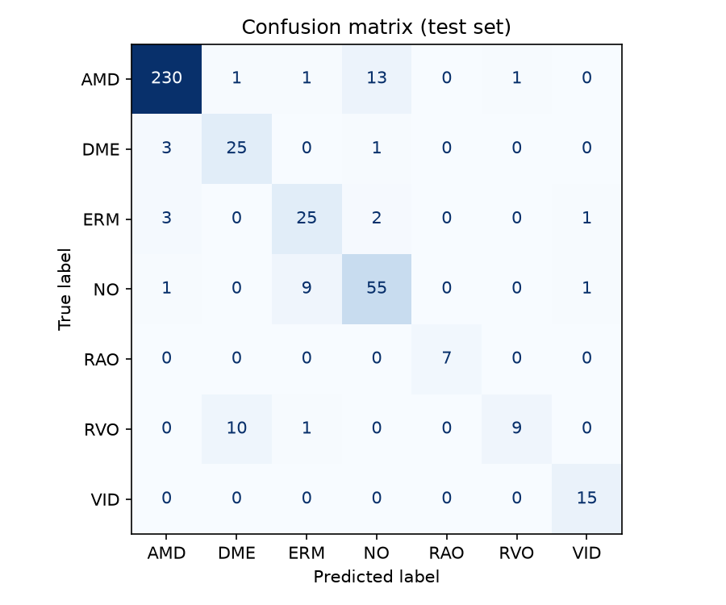
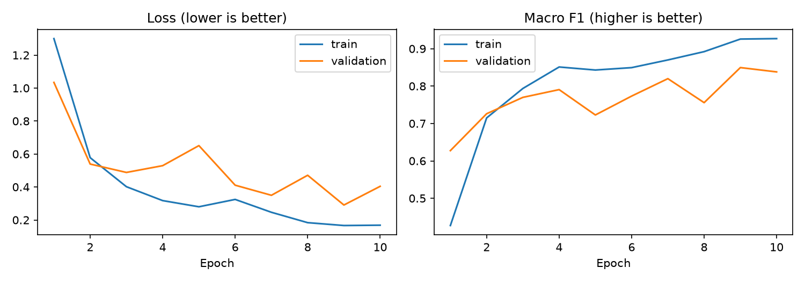
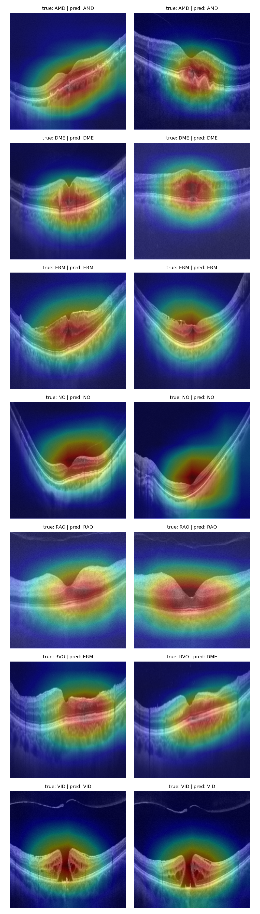

# Retinal OCT Disease Classification with Deep Learning

Classification of retinal diseases from optical coherence tomography (OCT) images using transfer learning (ResNet18) in PyTorch, with a patient-level data split, class-imbalance handling and Grad-CAM interpretability.

> Learning project focused on biomedical image analysis. **Not validated for clinical use.**

## Summary

- **Task:** multi-class classification of OCT B-scans (AMD, DME, ERM, normal, RAO, RVO, VID).
- **Data:** [OCTDL](https://data.mendeley.com/datasets/sncdhf53xc/4) (Kulyabin et al., *Scientific Data*, 2024), version 4.
- **Model:** ResNet18 pre-trained on ImageNet; only the last residual block and the classifier are fine-tuned.
- **Key methodological choices:**
  - Train / validation / test split **by patient** (no patient appears in more than one set) to avoid data leakage.
  - Class-weighted loss to handle strong class imbalance.
  - Model selection by validation **macro-F1** rather than accuracy.
  - **Grad-CAM** to inspect which image regions drive the predictions.

## Results

Evaluation on a held-out test set of 414 images from 162 patients (patient-level split; ResNet18, 10 epochs, CPU).

| Metric (test set) | Value |
|---|---|
| Macro F1 | 0.830 |
| Accuracy | 0.884 |
| Macro AUC (one-vs-rest) | 0.986 |

| Class | Precision | Recall | F1 | Test images |
|---|---|---|---|---|
| AMD | 0.970 | 0.935 | 0.952 | 246 |
| DME | 0.694 | 0.862 | 0.769 | 29 |
| ERM | 0.694 | 0.806 | 0.746 | 31 |
| NO (normal) | 0.775 | 0.833 | 0.803 | 66 |
| RAO | 1.000 | 1.000 | 1.000 | 7 |
| RVO | 0.900 | 0.450 | 0.600 | 20 |
| VID | 0.882 | 1.000 | 0.938 | 15 |





**Main observations:**
- AMD and VID are classified best. RAO is perfect but has only 7 test images, so it is not a reliable estimate.
- RVO is the weakest class (recall 0.45); half of the RVO test images were predicted as DME, plausibly because both can present with macular edema on OCT (hypothesis, not clinically reviewed).
- Grad-CAM shows the model focuses on the central retina rather than on borders or background, but the maps are coarse and similar across classes, so they do not prove lesion-level localisation.
- Mild overfitting (train F1 0.93 vs validation ~0.84) and a noisy validation curve, due to very few validation images in rare classes.

## Repository structure

```
.
├── notebooks/
│   ├── 01_data_exploration_and_split.ipynb   # EDA and patient-level split
│   └── 02_model_and_results.ipynb            # training, evaluation, Grad-CAM
├── common.py          # dataset, transforms, model, Grad-CAM
├── prepare_data.py    # builds the manifest and patient-level split
├── train.py           # command-line training
├── evaluate.py        # command-line evaluation
├── requirements.txt
└── data/              # not tracked; see "Data" below
```

## Data

Download OCTDL (images and metadata CSV) from [Mendeley Data](https://data.mendeley.com/datasets/sncdhf53xc/4) and check its license before use. The images are not included in this repository. Expected layout: one subfolder per disease inside a data folder, plus the metadata CSV.

## How to run

```bash
python -m venv .venv
source .venv/bin/activate          # Windows: .venv\Scripts\activate
pip install -r requirements.txt
```

**Notebooks (recommended):** run `notebooks/01_data_exploration_and_split.ipynb` first (set `DATA_DIR` and `CSV_PATH`), then `notebooks/02_model_and_results.ipynb`.

**Command line:**

```bash
python prepare_data.py --data-dir PATH/TO/DISEASE_FOLDERS --csv PATH/TO/metadata.csv
python train.py --epochs 10
python evaluate.py
```

## Limitations

- Classes with few images have very few test cases, so their metrics are unreliable.
- Single dataset and single split; no external validation on data from another centre or device.
- Not intended for clinical use.

## Possible extensions

- External validation on a second OCT dataset.
- Comparison with other architectures and patient-level cross-validation with confidence intervals.
- Segmentation to quantify imaging biomarkers (e.g. fluid volume).

## Reference

Kulyabin M. et al. *OCTDL: Optical Coherence Tomography Dataset for Image-Based Deep Learning Methods.* Scientific Data, 2024.
